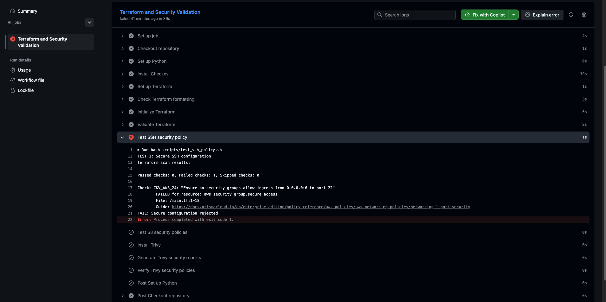
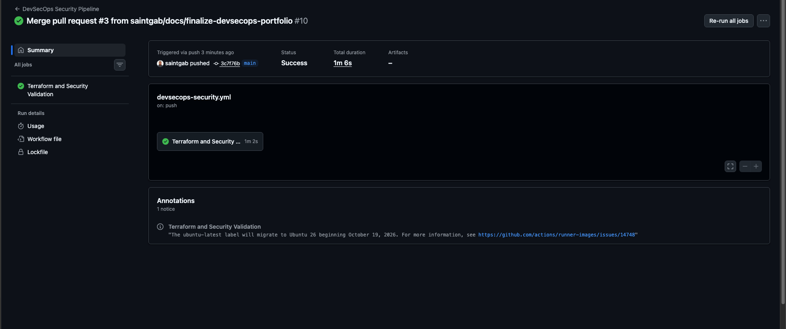

# DevSecOps & Cloud Security Automation Lab

## Overview

A hands-on DevSecOps engineering project demonstrating how to
identify, remediate, and prevent insecure AWS infrastructure
changes through automated security testing.

The project integrates Terraform, Checkov, Trivy, Python,
Bash, and GitHub Actions into a continuous security
validation pipeline.

## Key Achievements

- Built an automated Infrastructure as Code security pipeline.
- Developed positive and negative security regression tests.
- Detected unrestricted SSH access and unsafe S3 configurations.
- Implemented S3 versioning and lifecycle controls.
- Reduced Trivy findings from 8 to 2 in the lab examples.
- Validated security scanning on GitHub Actions.
- Demonstrated a failed pull request caused by insecure Terraform.
- Enforced required security checks through GitHub branch rules.
- Remediated the vulnerability and verified the pipeline turned green.

No AWS infrastructure was deployed.

## Technology Stack

| Technology | Purpose |
|---|---|
| Terraform | AWS Infrastructure as Code |
| Checkov | Terraform security policy scanning |
| Trivy | Independent misconfiguration scanning |
| Python | Security regression verification |
| Bash | Automated security test execution |
| GitHub Actions | CI/CD security automation |
| GitHub Rulesets | Required checks before merging |

## Security Controls

### SSH Exposure

Insecure configuration:
- TCP port 22 open to 0.0.0.0/0.

Remediation:
- Removed unrestricted inbound SSH access.

Detection:
- Checkov CKV_AWS_24
- Trivy AWS-0107

### S3 Public Access

Insecure configuration:
- All four S3 public-access-block settings disabled.

Remediation:
- Enabled the four S3 public-access-block protections.

Detection:
- Checkov CKV_AWS_53 through CKV_AWS_56
- Corresponding Trivy S3 misconfiguration checks

### S3 Data Protection

Additional controls:
- S3 bucket versioning enabled.
- Lifecycle expiration for noncurrent object versions.
- Terraform and security policy validation.

## CI/CD Security Pipeline

The GitHub Actions workflow performs:

1. Repository checkout and dependency setup.
2. Terraform formatting and configuration validation.
3. Checkov SSH security regression tests.
4. Checkov S3 public-access regression tests.
5. Trivy scanning of insecure and secure configurations.
6. Python verification of expected security findings.

A GitHub branch ruleset requires the security validation
check to pass before changes can be merged into main.

## Security Gate Demonstration

A controlled pull request introduced unrestricted SSH access
into a Terraform security group.

Observed results:
- Terraform validation passed.
- Checkov detected the insecure SSH rule.
- GitHub Actions reported a failed required check.
- GitHub prevented merging through the configured ruleset.

After removing the vulnerable rule, the pipeline passed.
The demonstration pull request was closed without merging.

## Test Locally

Create an isolated Python environment and install Checkov:

    python3 -m venv .venv
    source .venv/bin/activate
    python -m pip install -r requirements-dev.txt

Run the Checkov regression tests:

    bash scripts/test_ssh_policy.sh
    bash scripts/test_s3_policy.sh

Generate Trivy reports with an installed Trivy CLI:

    mkdir -p reports
    trivy config --format json --output reports/trivy-insecure.json --exit-code 0 terraform/insecure
    trivy config --format json --output reports/trivy-secure.json --exit-code 0 terraform/secure
    python3 scripts/verify_trivy_reports.py

## Architecture and Evidence

- [Security Architecture](docs/architecture.md)
- [Security Validation Evidence](docs/security-evidence.md)
- [GitHub Actions Runs](https://github.com/saintgab/devsecops-cloud-security-lab/actions)

## CI/CD Security Validation Evidence

### 1. Insecure Terraform rejected by Checkov

An intentionally insecure SSH rule triggered Checkov
policy `CKV_AWS_24`, causing GitHub Actions to fail.
The required status check also blocked merging.

### 2. Successful DevSecOps security pipeline

After remediation, the security validation workflow
passed on the protected `main` branch.

## Known Limitations

The remediated example still has outstanding findings
including S3 access logging and customer-managed KMS
encryption recommendations.

Additional full-scan Checkov findings require assessment.
The standalone security group is not attached to a workload.

The regression tests cover selected controls and do not
constitute a complete infrastructure security assessment.

All deliberately insecure configurations are code-only
test fixtures. They must not be deployed.

## Author

Cybersecurity engineering portfolio:
https://github.com/saintgab
