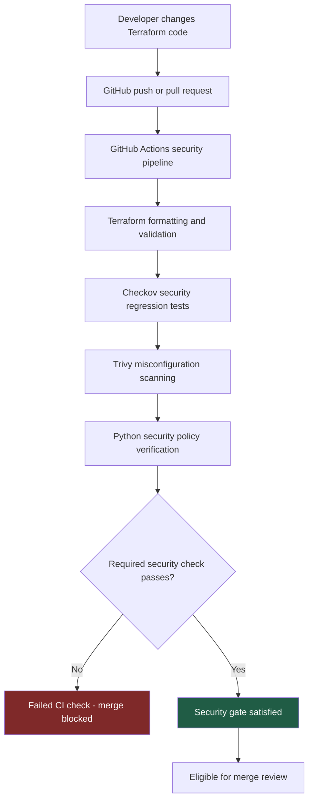

# DevSecOps Security Architecture

## Overview

This project demonstrates how automated security controls
detect unsafe AWS Terraform configurations before merging.

## CI/CD Security Workflow

## Security Controls

### Terraform
Validates the structure of AWS infrastructure definitions.

### Checkov
Tests infrastructure security policies, including:
- CKV_AWS_24: Unrestricted SSH ingress
- CKV_AWS_53: S3 public ACL blocking
- CKV_AWS_54: S3 public policy blocking
- CKV_AWS_55: Ignore public ACLs
- CKV_AWS_56: Restrict public buckets

### Trivy
Performs independent Terraform misconfiguration scanning
and identifies remaining configuration weaknesses.

### Python and Bash
Verify expected scan results and detect security regressions.

### GitHub Actions
Executes automated checks on pushes and pull requests.

### GitHub Branch Ruleset
Requires successful security validation before merging
changes into the protected main branch.

## Validated Security Gate

An intentionally insecure SSH rule was introduced on
a separate test branch.

Checkov detected unrestricted SSH access, GitHub Actions
failed, and the required status check blocked merging.

After remediation, the pipeline passed.

The demonstration pull request was closed without merging.

## Deployment Boundary

This project validates Terraform configuration without
deploying AWS infrastructure.

The intentionally insecure configurations are test fixtures
and must never be deployed.
